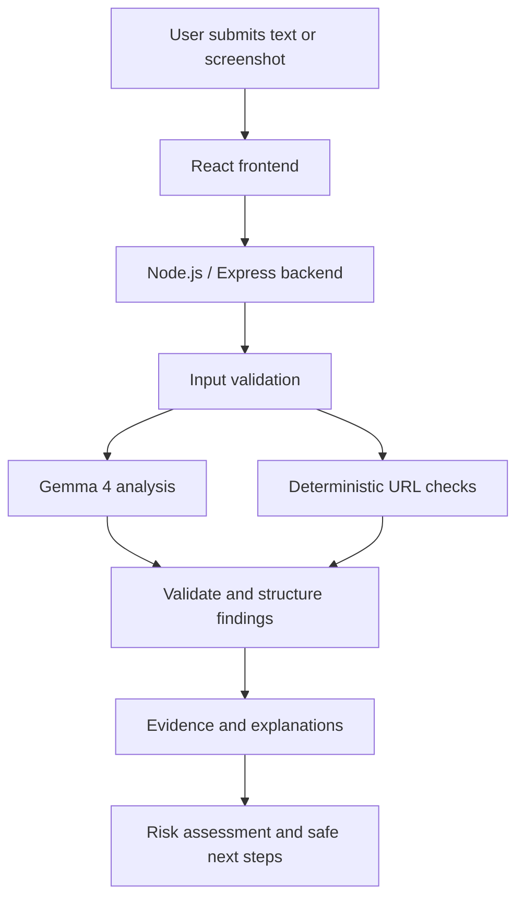

# 🔎 LinkSleuth

### Investigate suspicious messages. Understand the evidence. Stay safer online.

**LinkSleuth** is an open-weight AI-powered phishing investigation platform designed to help people understand suspicious SMS messages, emails, and website screenshots.

Powered by **Google Gemma 4**, LinkSleuth aims to go beyond a simple phishing verdict by identifying potential warning signs, explaining supporting evidence, communicating uncertainty, and recommending practical next steps.

> **See the evidence. Understand the risk. Choose the safer next step.**

<p align="center">
  
  
  
  
</p>

---

## 🎯 The Problem

Phishing attacks exploit trust, urgency, impersonation, and deceptive links to manipulate people into revealing sensitive information.

Many tools simply label a message as *safe* or *malicious*. That leaves users wondering:

- What exactly looks suspicious?
- Why should I be concerned?
- Is there enough evidence to make a judgment?
- What should I do next?

## 💡 Our Solution

LinkSleuth turns suspicious messages into understandable security investigations.

Instead of returning only a binary classification, it aims to provide:

- **Evidence:** Specific phrases or visible elements that may indicate phishing.
- **Explanation:** Why each indicator matters.
- **Uncertainty:** What cannot be confirmed from the submitted content.
- **Action:** Practical steps to verify a message safely.

## ✨ Key Features

Update this section to reflect the features actually implemented in the repository.

- 🧠 **Gemma 4 analysis** — Use an open-weight AI model for substantive message investigation.
- 🖼️ **Screenshot investigation** — Analyze screenshots of suspicious messages and webpages where supported by the configured model.
- 🔍 **Evidence-based explanations** — Connect findings to specific text or visible indicators.
- ⚠️ **Risk assessment** — Present low-concern, suspicious, high-concern, or inconclusive findings.
- 🛡️ **Actionable safety guidance** — Help users verify messages through independent, trusted channels.
- 🔗 **Cautious URL inspection** — Identify selected URL warning signs without automatically visiting submitted links.
- ⚖️ **Uncertainty-aware analysis** — Avoid treating model-generated hypotheses as proven facts.
- 🔐 **Privacy-conscious design** — Keep API credentials server-side and minimize unnecessary data retention.

## 🧠 Why Gemma 4?

Gemma 4 is an open-weight model family from Google that supports multimodal capabilities, including image understanding for supported model variants.

LinkSleuth uses Gemma 4 as its core analysis engine to interpret user-submitted content and generate structured, understandable findings.

### Model information

| Property | Details |
|---|---|
| Model family | Google Gemma 4 |
| Intended use | Defensive phishing investigation and security awareness |
| Integration | Google GenAI SDK, when using the hosted API |
| Model identifier | `gemma-4-26b-a4b-it` — verify availability in your environment |
| Official documentation | [Gemma documentation](https://ai.google.dev/gemma/docs/core) |
| Model card | [Gemma 4 model card](https://ai.google.dev/gemma/docs/core/model_card_4) |

**Open-weight clarification:** Access to model weights does not automatically mean the entire model development process is open source. Review the model's applicable license and terms before use.

## 🔬 How It Works



### Investigation pipeline

1. **Input:** The user submits a suspicious message, email, screenshot, or URL as text.
2. **Validation:** The backend validates input size and format.
3. **AI analysis:** Gemma 4 interprets the supplied content and identifies potential warning signs.
4. **Evidence review:** The application presents supporting evidence and uncertainty.
5. **Deterministic checks:** Separate application code performs selected URL checks.
6. **Result:** The user receives a structured investigation with practical next steps.

AI-generated findings and deterministic checks should be presented separately so users can distinguish model interpretation from rule-based observations.

## 🏗️ Technology Stack

| Layer | Technology |
|---|---|
| Frontend | React, Vite |
| Backend | Node.js, Express |
| AI model | Google Gemma 4 |
| AI SDK | `@google/genai` |
| Language | JavaScript |
| Version control | Git, GitHub |

Update this table to match the actual dependencies in the repository.

## 🚀 Getting Started

### Prerequisites

- Node.js and npm
- Git
- A Google AI Studio API key with access to the selected Gemma model
- A compatible browser

### 1. Clone the repository

```bash
git clone https://github.com/Vineet-Chandel/MLH-HACTOBER.git
cd MLH-HACTOBER
```

### 2. Install dependencies

If the project uses separate frontend and backend directories:

```bash
cd server
npm install

cd ../client
npm install
```

If the project has a different folder structure, follow the package files and scripts in the repository.

### 3. Configure environment variables

Create a `.env` file in the backend directory:

```env
GEMINI_API_KEY=your_api_key_here
PORT=3001
```

Replace the placeholder with your own API key locally.

**Never commit your actual `.env` file.** Ensure `.env` is included in `.gitignore` and provide an `.env.example` file containing placeholders only.

### 4. Run the backend

From the backend directory, use the script defined in `package.json`. For example:

```bash
npm run dev
```

### 5. Run the frontend

From the frontend directory:

```bash
npm run dev
```

Open the local URL printed by Vite.

> These commands are examples. Confirm the actual directory names and scripts before publishing this README.

## 🧪 Demonstration Scenarios

Use synthetic messages that contain no real personal or financial information.

### Scenario 1 — Suspicious credential request

A fictional bank message creates urgency and asks the recipient to verify account details using an unfamiliar link.

The investigation should explain the credential request, identify relevant warning signs, and recommend independent verification.

### Scenario 2 — Routine notification

A fictional service notification provides a normal update without requesting credentials or payment.

The system should avoid automatically treating the message as malicious simply because it contains a link or unusual wording.

### Scenario 3 — Ambiguous message

A fictional delivery notification includes a link but provides insufficient context to determine whether it is legitimate.

The system should communicate uncertainty and recommend safe verification rather than inventing certainty.

**These are test scenarios, not guaranteed model outputs.** The demo should display the results returned by the running model.

## 🔐 Security and Responsible Use

LinkSleuth is intended for defensive security awareness.

- Never submit real passwords, OTPs, payment credentials, or other secrets.
- Treat user-provided content as untrusted input.
- Do not automatically open suspicious URLs or execute remote content.
- Keep API keys on the backend.
- Validate uploaded files and model responses.
- Avoid logging sensitive user submissions.
- Communicate uncertainty clearly.
- Do not treat AI output as definitive proof of malicious activity.

LinkSleuth cannot guarantee that a message, sender, URL, or website is safe.

## 🗺️ Roadmap

- [ ] Verify the real Gemma 4 integration.
- [ ] Complete text-based investigation.
- [ ] Complete screenshot analysis.
- [ ] Add evidence-linked findings.
- [ ] Implement deterministic URL checks.
- [ ] Test benign and ambiguous messages.
- [ ] Improve validation and error handling.
- [ ] Add message comparison.
- [ ] Publish a reproducible demo.
- [ ] Complete repository documentation.

Check off features only after they work.

## 🤝 Contributing

Contributions and improvements are welcome.

1. Fork the repository.
2. Create a feature branch.
3. Make a focused change.
4. Test your changes.
5. Open a pull request describing the improvement.

Never include API keys, private messages, or sensitive information in commits or issues.

## 📜 License

The LinkSleuth application code is intended to be released under the **MIT License**, provided in the root `LICENSE` file.

This license applies to the project code covered by that file. Gemma 4, its model weights, and third-party dependencies remain subject to their respective licenses and terms.

See the [`LICENSE`](./LICENSE) file for details.

## 🏆 Hackathon

Built for the **MLH Hacktoberfest Open Source AI Challenge**.

LinkSleuth explores how open-weight AI can make phishing investigation more understandable, evidence-based, and actionable.

---

<p align="center">
  <strong>LinkSleuth</strong><br/>
  See the evidence. Understand the risk. Choose the safer next step.
</p>
